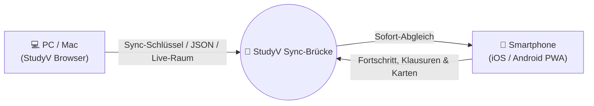

<div align="center">

<br />


# StudyV

### **Deine All-in-One Lernplattform für Berufsschule, Klausuren & Prüfungsvorbereitung**

*Interaktives Bento-Dashboard • 3D-Karteikarten • 6-Fragen-Quiz-Engine • 5-Achsen-Kompetenz-Radar • Handy & PC Sync*

<br />

[](#)
[](#architektur--tech-stack)
[](#5-app-designs)
[](#installation--github-pages)

<br />

[✨ Features](#-highlight-features) •
[📚 Lernfächer](#-integrierte-lernfächer--module) •
[🎨 App-Designs](#-5-app-designs) •
[🔄 Handy & PC Sync](#-handy--pc-synchronisation) •
[🚀 Setup](#-installation--github-pages)

<br />

</div>

---

> [!TIP]
> **Zero-Build & 100 % Browser-nativ:** StudyV läuft komplett ohne Backend-Zwang oder Build-Prozess in einer einzigen `index.html` — perfekt für **GitHub Pages**, lokalen Offline-Einsatz und als **Web-App auf dem Smartphone-Homescreen**.

---

## ✨ Highlight-Features

<table>
  <tr>
    <td width="50%" valign="top">
      <h3>📊 Cobalt Bento Dashboard</h3>
      <p>Behalte deinen gesamten Lernstand in Echtzeit im Blick:</p>
      <ul>
        <li><strong>Live-Lernquote Gesamt</strong> inkl. animiertem Spitzenreiter-Balken</li>
        <li><strong>Interaktiver SVG-Lernverlauf</strong> (<code>1T</code> / <code>1W</code> / <code>1M</code>) mit Hover-Tagespunkten</li>
        <li><strong>Tagesziel-Tracker</strong> mit <code>+</code>/<code>−</code> Direktsteuerung & Schimmer-Balken</li>
        <li><strong>Prüfungs-Countdown</strong> zur nächsten Klassenarbeit</li>
      </ul>
    </td>
    <td width="50%" valign="top">
      <h3>⚡ 6-Fragen-Quiz &amp; Lernstoff-Drawer</h3>
      <p>Trainiere gezielt bis zur Prüfungsreife — Modul für Modul:</p>
      <ul>
        <li><strong>30 richtige Antworten = Done:</strong> Jeder Treffer zählt exakt <code>+1</code></li>
        <li><strong>Intelligenter Fragenpool:</strong> Keine doppelten Fragen innerhalb einer Serie</li>
        <li><strong>Glassmorphism-Quiz-Popup</strong> mit Tipp-Funktion &amp; Sofort-Erklärung</li>
        <li><strong>Integrierter Lernstoff-Drawer</strong> mit Kompaktwissen, Checklisten &amp; Notizen</li>
      </ul>
    </td>
  </tr>
  <tr>
    <td width="50%" valign="top">
      <h3>🃏 3D-Flip-Karteikarten (Karten)</h3>
      <p>Active Recall im modernen Neon-Frame-Design:</p>
      <ul>
        <li><strong>Weiche 3D-Kartenwendung</strong> mit wechselndem äußerem Farbverlauf</li>
        <li><strong>Fach-Filter &amp; Deck-Fortschrittsleiste</strong> für schnelles Springen</li>
        <li><strong>„Als gewusst markieren“</strong>-Tracking inkl. Dashboard-Anbindung</li>
        <li><strong>Eigene Merkzettel</strong> für Formeln, Paragrafen &amp; Vokabeln</li>
      </ul>
    </td>
    <td width="50%" valign="top">
      <h3>🗂️ Project Hub (4 Ansichten)</h3>
      <p>Strukturierte Lernordner mit 20 einzigartigen Modul-Illustrationen:</p>
      <ul>
        <li><strong>5 farbcodierte Fächer-Ordner</strong> mit 3D-Tilt &amp; Spotlight-Effekt</li>
        <li><strong>Kanban, List, Timeline &amp; Table</strong> per Klick umschaltbar</li>
        <li><strong>Drag &amp; Drop</strong> zwischen <em>To Do</em> und <em>Done</em></li>
        <li><strong>Einzel-Reset (<code>↺</code>)</strong> direkt auf jedem Lernmodul</li>
      </ul>
    </td>
  </tr>
  <tr>
    <td width="50%" valign="top">
      <h3>📅 Chrono-Matrix Kalender</h3>
      <p>Nie wieder Klausuren oder Lerninhalte vergessen:</p>
      <ul>
        <li><strong>Animierte Monats-Matrix</strong> mit HUD-Eckenmarkierungen &amp; Magnet-Lichtfeld</li>
        <li><strong>Prüfungs-Fahrplan</strong> mit radialen Countdown-Ringen</li>
        <li><strong>„Was kommt dran?“</strong>-Stoffübersicht &amp; Fach-Filter</li>
        <li><strong>Direktstart</strong> vom Prüfungstermin ins passende Übungsfach</li>
      </ul>
    </td>
    <td width="50%" valign="top">
      <h3>📡 Kompetenz-Observatorium (Reports)</h3>
      <p>Visuelle Lern-Telemetrie für maximale Prüfungssicherheit:</p>
      <ul>
        <li><strong>Interaktives 5-Achsen-Radar-Netz</strong> mit rotierender Scan-Linie</li>
        <li><strong>4 animierte SVG-Ring-Gauges</strong> (Fragen, Module, Karten, Tagesziel)</li>
        <li><strong>Fächer-Spektrum</strong> mit Modul-Equalizer-Balken</li>
        <li><strong>1-Klick Schwachstellen-Training</strong> für das schwächste Modul</li>
      </ul>
    </td>
  </tr>
</table>

---

## 📚 Integrierte Lernfächer & Module

StudyV umfasst **5 Hauptfächer** mit insgesamt **20 liebevoll illustrierten Lernmodulen** und hunderten prüfungsnahen Fragen:

| Farbe | Fach | Module | Schwerpunkte |
| :---: | :--- | :---: | :--- |
|  | **Rechnungswesen** | `4 Module` | Jahresabschluss & AfA, Umsatzsteuer & Vorsteuer, Bestandskonten & Buchungssätze, Inventur & Bilanz |
|  | **Gesprächsgestaltung** | `4 Module` | Grundlagen der Kommunikation, Mikroexpressionen & Mimik, Sprachanruf, Videokonferenz & Interkultur *(120 einzigartige Fragen)* |
|  | **Sozialkunde** | `4 Module` | Bundeskanzler & Regierung, Grundrechte (Art. 1–19 GG), Bundesverfassungsgericht, Bundesrat *(120 einzigartige Fragen)* |
|  | **Englisch** | `4 Module` | Business Correspondence & E-Mails, Telephoning & Meetings, Complaints & Customer Service, Vocabulary & Grammar |
|  | **Kunden akquirieren & binden** | `4 Module` | Kundenakquise & AIDA, Zielgruppen & ABC-Analyse, Kundenbindung & CRM, Servicequalität & Cross-Selling |

<details>
<summary><strong>🔍 Alle 20 Lernmodule im Detail aufklappen</strong></summary>
<br />

- **Rechnungswesen:** `Jahresabschluss & AfA` • `Umsatzsteuer & Vorsteuer` • `Bestandskonten & Buchungssätze` • `Inventur & Bilanz`
- **Gesprächsgestaltung (LF 7):** `Grundlagen der Kommunikation` • `Mikroexpressionen & Mimik` • `Gespräche per Sprachanruf` • `Videokonferenz & Interkultur`
- **Sozialkunde:** `Bundeskanzler & Regierung` • `Grundrechte im Grundgesetz` • `Bundesverfassungsgericht` • `Bundesrat`
- **Englisch:** `Business Correspondence & E-Mails` • `Telephoning & Meetings` • `Complaints & Customer Service` • `Business Vocabulary & Grammar`
- **Kunden akquirieren & binden:** `Kundenakquise & Neukundengewinnung` • `Zielgruppenanalyse & Kundenbedürfnisse` • `Kundenbindung & CRM-Systeme` • `Servicequalität & Cross-Selling`

</details>

---

## 🎨 5 App-Designs

Im **Studio Control Deck (`Settings`)** lässt sich das komplette Farbschema der App live per Klick wechseln — inklusive Mini-UI-Vorschaukarten:

| Design | Stil & Atmosphäre | Farbwelt |
| :--- | :--- | :--- |
| **Obsidian Dark** *(Standard)* | Tiefschwarzes Fokus-Design mit Kobaltblau | `#111113` • `#1A1A1D` • `#3B82F6` |
| **Midnight Indigo** | Sattes Nachtblau mit modernem Indigo-Glow | `#0B0F1A` • `#141C30` • `#6366F1` |
| **Forest Emerald** | Ruhiges Dunkelgrün mit Smaragd-Akzenten | `#0A110F` • `#13211D` • `#10B981` |
| **Sunset Amber** | Warmes Espresso-Dark mit goldenem Bernstein | `#14100E` • `#221B17` • `#F59E0B` |
| **Daylight Clean** | Kontrastreiches, klares Tageslicht-Design | `#F3F4F8` • `#FFFFFF` • `#2563EB` |

---

## 🔄 Handy & PC Synchronisation

Dein Lernstand gehört dir — und bleibt auf jedem Gerät synchron:



1. **Sofort-Transfer per Sync-Schlüssel:** In den *Einstellungen* auf **„Sync-Schlüssel kopieren“** klicken (`STUDY-V1:...`) und auf dem zweiten Gerät einfügen.
2. **Sync-Datei (`.json`):** Komplettes Backup aller Modulstände, Karteikarten, Termine und Merkzettel mit einem Klick speichern oder importieren.
3. **Live Sync-Raum (`SV-XXXX`):** Automatischer Echtzeit-Abgleich über gemeinsamen Raum-Code (sobald eine Cloud-Konfiguration hinterlegt ist).

---

## 🛠️ Architektur & Tech Stack

StudyV setzt bewusst auf maximale Geschwindigkeit, Übersichtlichkeit und Wartungsfreiheit:

- **Frontend:** Semantisches HTML5, Modern Vanilla JavaScript (ES6+), Tailwind CSS
- **Design System:** Eigene **Plump Solid** SVG-Ikonografie, GPU-beschleunigte CSS-Keyframes, CSS Custom Properties für Live-Theming
- **Visualisierungen:** 100 % native Inline-SVG-Charts (Lernverlauf-Kurve, 5-Achsen-Kompetenz-Radar, Ring-Gauges, 24-Tick-Segmentbalken & 20 individuelle Modul-Illustrationen)
- **Persistenz:** Automatisches `localStorage`-Debouncing + optionaler Firebase Firestore Live-Sync
- **Performance:** Entkoppeltes Quiz-Rendering, `requestAnimationFrame`-Hover-Throttling & automatisches Pausieren von Hintergrund-Animationen im Quiz-Modus

---

## 🚀 Installation & GitHub Pages

### 1. Lokal starten
Kein `npm install` nötig — einfach Repository klonen und `index.html` im Browser öffnen:

```bash
git clone https://github.com/<DEIN-USERNAME>/StudyV.git
cd StudyV
# index.html direkt im Browser öffnen
```

### 2. Kostenlos über GitHub Pages hosten
1. Lade `index.html` und `IconV.png` in dein GitHub-Repository hoch.
2. Gehe zu **Settings → Pages**.
3. Wähle unter **Source** den Branch `main` und den Ordner `/ (root)` aus und klicke auf **Save**.
4. Nach ca. 1 Minute ist deine App live unter `https://<DEIN-USERNAME>.github.io/<REPO-NAME>/`.

### 3. Als App auf dem Handy installieren (iOS & Android)
- **iPhone (Safari):** Teilen-Symbol antippen → **„Zum Home-Bildschirm“** → fertig (inkl. eigenem `StudyV`-App-Icon!).
- **Android (Chrome):** Menü (`⋮`) → **„App installieren“** bzw. **„Zum Startbildschirm hinzufügen“**.

---

## ⌨️ Tastenkürzel

| Shortcut | Aktion |
| :---: | :--- |
| <kbd>Ctrl</kbd> / <kbd>⌘</kbd> + <kbd>K</kbd> | Globale Schnellsuche über alle Fächer & Lernmodule öffnen |
| <kbd>ESC</kbd> | Geöffnetes Quiz, Modal oder Lernstoff-Drawer schließen |

---

<div align="center">

<sub>Gebaut mit Fokus auf klares Design, flüssige Animationen und echte Prüfungssicherheit • <strong>StudyV</strong></sub>

</div>
